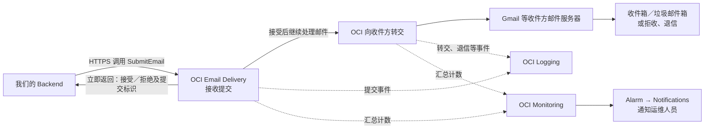

# OCI 邮件提交后流程

`SubmitEmail` 是 OCI Email Delivery 的 **HTTPS API 操作**，不是一个独立容器，也不是
“邮件已到收件箱”的回执。本图从 Backend 调用该操作开始，与
[提交前流程](submit-before.md)衔接。它描述已接受的
[ADR-019](../../decisions/ADR-019-oci-email-delivery-provider.md) 和
[ADR-020](../../decisions/ADR-020-staging-mail-application-alerts.md) 设计；Staging 目前仍为 mock，
尚未用真实邮件完成此链路的端到端验收。

阅读要点：

- `SubmitEmail` 接受响应只说明 OCI 接收了提交。Backend 将该次调用的状态和
  Message-ID、envelope ID、request ID 等安全标识写入 PostgreSQL；`mail_job.status=sent`
  仅表示 **OCI accepted**，不表示 `relay` 或收件箱送达。明确拒绝与结果不明按 ADR-019
  分类；`delivery_unknown` 不自动重发。
- 图中的“OCI 向收件方转交”是 Email Delivery 内部的后续处理阶段，**不是我们要部署的第二个
  OCI 服务**。`relay` 表示已转交收件方邮件服务器；收件方仍可能放入垃圾邮件箱、拒收或产生退信。
- Email Domain、approved sender 与 DKIM 是发件身份/域名配置；IAM 和 Instance Principal
  用于授权入口调用。这些是配置与安全边界，不是邮件正文依次穿过的服务。
- OCI Logging 的 `OutboundAccepted` 和 `OutboundRelayed` 是旁路事件记录，可供有权限的运维人员
  按 Message-ID 人工对账。OCI Monitoring 聚合服务指标；Alarm 满足条件后通过 Notifications
  通知运维。它们都不搬运邮件，也不自动把异步事件写回应用数据库。
- 当前没有接收 OCI 异步投递事件的应用 webhook，也没有自动同步产品级
  `delivered/bounced/complained` 状态；后者属于可选后续 Issue #146。

Oracle 依据：[HTTPS `SubmitEmail`](https://docs.oracle.com/en-us/iaas/Content/Email/Concepts/email-submission-configure-https-connection.htm)、
[Email Delivery 日志事件](https://docs.oracle.com/en-us/iaas/Content/Email/Reference/log-guide.htm)、
[Email Delivery 指标](https://docs.oracle.com/en-us/iaas/Content/Email/Reference/guide-to-metrics-logs.htm)。
