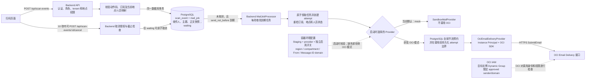

# OCI 邮件提交前流程

本图的终点是 **Backend 调用 OCI Email Delivery 的 HTTPS `SubmitEmail`**，不是邮件送达。
它描述当前代码路径；Staging 运行时仍以 `MAIL_PROVIDER=mock`、`REAL_MAIL_SEND_ENABLED=false`
为安全默认，图中的 OCI 分支只有在另行批准并满足门禁后才会执行。提交后的独立流程见
[OCI 邮件提交后流程](submit-after.md)。依据已接受的
[ADR-003](../../decisions/ADR-003-tenant-context-and-subscription-gating.md)、
[ADR-017](../../decisions/ADR-017-scan-send-cancellation-grace-period.md) 与
[ADR-019](../../decisions/ADR-019-oci-email-delivery-provider.md)。

阅读要点：

- `POST /api/scan-events` **不直接发送邮件**。它在 tenant、地点、人员映射和订阅检查后，
  将扫码事实与唯一 `mail_job` 一起提交；收件地址只从当时的人员邮箱固化为 `mail_job.to_email`，
  客户端不能指定或覆盖 From、收件地址、region 或 Provider。
- `waiting` 的 10 秒是服务端数据库时间决定的取消窗口；取消成功与 worker 领取互斥。
  Worker 到期后原子领取，创建 attempt，发送前再次检查订阅及资源状态。
- OCI 分支在 PostgreSQL 中跨 Backend 实例预约提交间隔，阶段性最多 20 次/秒；这不是 OCI
  tenancy 的实际配额。节流时任务延后，**不调用 `SubmitEmail`**。Provider 调用边界先持久化，
  避免进程重启后把结果不明的任务当作从未尝试过。
- `OciEmailDeliveryProvider` 通过 Instance Principal 获取运行身份，使用 OCI SDK 调用 HTTPS
  `SubmitEmail`，并关闭 SDK 自动重试。这里没有另一个独立部署的 mailer 容器；Worker 在 Backend
  内经 `MailJobsService` 调用 Provider。
- 另有 `POST /api/mail-jobs/:id/send` 可受控处理已到期、可发送的任务；它仍进入相同的
  `MailJobsService` 领取和门禁流程，不接受新的收件地址或发件人。
